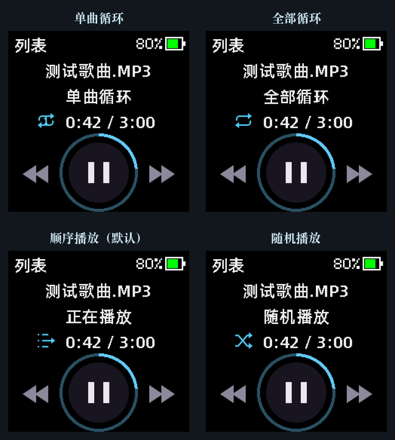

# C208 固件功能扩展

为搜狗 C208 录音笔制作的非官方实验性补丁工程，作者：**清风惹尘丶**。最新保留版本为 **V0141（2026-11-22）**，功能包括原录音、小智语音、全屏 MP3 播放和半屏音量面板。

**刷机可能导致黑屏、无法开机、录音丢失或需要拆机恢复。当前没有经过实机验证的通用按键救砖方式，V0141 也没有新增自动回滚、镜像备份或增强 Recovery。** 请先读 [刷机与风险](docs/FLASHING.md) 和 [Recovery 状态](docs/RECOVERY.md)。

**有匹配编程器并具备拆机经验的用户，建议在首次刷机前先拆机备份本机完整 SPI Flash。** 请核对芯片、电压及读取结果，并将原始镜像私下保存；具体见 [编程器备份说明](docs/FLASHING.md#有编程器时先拆机备份原系统)。备份文件不能替代实际恢复通道的验证。

这是一套对固定二进制基线进行补丁的工程，不包含原厂完整系统源码。公开仓库保存新增实现、构建工具、素材和软件验证记录；原厂镜像、完整 OTA、身份配置和个人音频保留在本地，不提交 Git。

## 最新版本的功能

| 类别 | V0141 内容 |
| --- | --- |
| 原录音 | 保留原录音入口、录音物理键和原生回放流程；MP3、小智与录音切换时交接音频资源 |
| 小智语音 | Wi-Fi 配网、激活接入、语音收发、回复字幕；按住说话／单击开停／连续对话三种模式，设置页显示当前选择 |
| 唤醒 | 在小智主页亮屏时按连接状态发起一次重连；连接结果取决于 Wi-Fi、服务端和实际设备状态 |
| MP3 播放 | 全屏播放器、曲名／“列表”入口、单击列表播放、长按删除确认、右上角电量；设置页面可继续播放 |
| 播放模式 | 单曲循环、全部循环、顺序播放、随机播放；点击时间行左侧图标轮换，默认顺序播放，选择仅在本次开机内保留 |
| 物理按键 | MP3 模式下，录音物理键单击播放／暂停、双击下一首并播放、长按约 0.6 秒上一首并播放；触屏按实际控件功能工作 |
| 文件与手势 | `/Music` 中读取 MP3，忽略 `._song.mp3` 等点开头文件；MP3／小智／设置可左右循环切换，播放中进入小智先确认并暂停音乐 |
| 音量与界面 | MP3、小智上滑显示底部半屏音量；下滑或点上半屏收起。设置图标、当前模式小字、清风开机动画“风过，尘起。” |

音频回复尾部的静音、保活和 PCM 边界处理也已纳入当前代码，但真实设备的尾音、爆音及声音连续性仍需实测。不要把软件回放通过理解为所有硬件问题已解决。



上图为软件预览。更多说明见 [V0141 发布说明](firmware/V0141/RELEASE_NOTES.md)。

## 目录

```text
patches/                 新增功能源码：主界面、录音、MP3、Wi-Fi、小智
scripts/                 当前版本构建、校验、准备升级、隐私检查工具
tests/                   无需设备与私有镜像的可执行测试
assets/                  开机动画、播放模式图标及生成记录
third_party/             构建所需 BearSSL、Opus 上游源码与许可
build-support/           布局元数据、输入散列、公共 TLS 根证书
docs/                    功能、构建、刷机风险、隐私及 Recovery 说明
firmware/V0141/          最新版本描述、完整 OTA 的散列；不含 OTA 文件
verification/V0141/      已有软件验证记录的公开副本
research/recovery/       Recovery 方案和原生指令回放记录，尚未实现的新功能
_local/                  私有输入／完整 OTA／本地报告，Git 忽略
build/                   本机构建输出，Git 忽略
```

## 开始使用

仅检查公开源码，不需要设备或原厂镜像：

```sh
python3 scripts/run_checks.py
```

需要 Python 3.10+ 和支持 AddressSanitizer / UBSan 的 Clang；本次在 macOS 验证。源码构建还需要 Cortex-M4 交叉编译能力、LLVM 链接／归档工具，以及指定的本地原厂镜像和 V0121 基线。先按 [构建说明](docs/BUILDING.md) 准备输入；克隆公开仓库本身不会得到这些闭源输入。

核对本地保留的最新固件：

```sh
python3 scripts/verify_release.py \
  --package _local/firmware/V0141/SOGOUOTA.BIN \
  --original _local/inputs/sg-bak.bin \
  --elf _local/firmware/V0141/main.elf
```

V0141 OTA：8,388,624 字节，SHA-256：

```text
4a91383c0ae06ba16aa0772c42619ced8e4800b1d1d48dc9c75a106ee060d6f7
```

这是带容器头尾的 eMMC OTA，**不能当作 8MiB SPI 原始镜像直接烧录**。校验通过不代表适配任意 C208 或任意当前版本。

## 验证和限制

当前版本已有 23 组软件回放通过记录，覆盖播放模式、隐藏文件、按键、触屏、音量、录音及小智音频等路径，见 [验证说明](docs/VERIFICATION.md)。原生指令回放中的 Flash、文件系统、播放器和调度等边界存在模型；最新版本尚未完成整机断电、连续播放、实体 USB、故障恢复等完整验证。

当前补丁静态 RAM 占 3016 字节，预留 3072 字节；56 字节只是该静态区余量。堆、线程栈、音频缓冲仍另外占用 RAM。原启动区、Recovery 与 DSP 镜像保持不变，**不等于保证不会刷黑或能够自动恢复**。

公开问题时请按 [贡献说明](CONTRIBUTING.md) 提供经过脱敏的版本和故障步骤，不要上传录音、设备身份种子、Wi-Fi 密码或整片备份。许可边界见 [NOTICE](NOTICE.md)。
